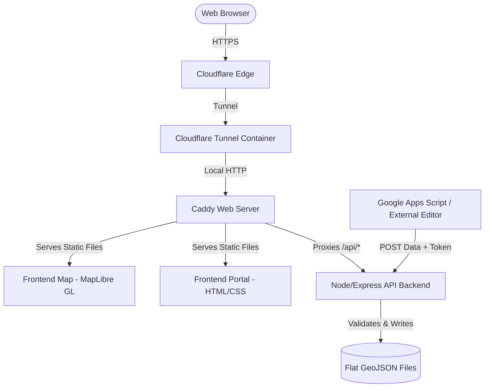

# Welcome to Westville - Interactive Map & Portal

An open-source, highly efficient interactive map and information portal built for the Borough of Westville, New Jersey. This project helps residents and visitors discover local establishments, public parking zones, township boundaries, and recreational parks.

The portal features a fully responsive, modern web interface with custom styling, high-performance web mapping, and an automated flat-file backend synchronized with a secure remote updater.

---

## Architecture Overview

The system is designed with a lightweight, secure, and easily hostable stack, utilizing Docker Compose to bundle and configure all services:



### 1. Web Portal (`/www`)
- Core informational pages (Welcome, Credits, Privacy & Terms).
- Built with vanilla CSS, semantic HTML5, and clean modern typography (Open Sans).
- Follows performance, accessibility, and SEO best practices with fully responsive layouts.

### 2. Interactive Map (`/map`)
- Full-screen interactive map built with [MapLibre GL JS](https://maplibre.org/) (an open-source, high-performance WebGL map library).
- Uses map tiles from [OpenFreeMap](https://openfreemap.org/) (free, unlimited open-source tile hosting) and OpenStreetMap vector data. No commercial third-party API keys or usage fees are required.
- Dynamic layer-switching controller utilizing `maplibre-gl-layer-control`.
- Generates high-quality PDF printout cards and local business directory pages on-device using `pdf-lib`.

### 3. API Backend (`/app`)
- Lightweight, secure Node.js [Express](https://expressjs.com/) backend.
- Exposes a `POST /api/map_data_save` endpoint to update map GeoJSON datasets on the fly.
- **Security Protections**:
  - `helmet` for robust, web-vulnerability header configurations.
  - `express-rate-limit` to prevent brute force and Denial of Service (DoS).
  - Timing-safe secure comparison of client tokens (`APPS_SCRIPT_TOKEN`) to prevent side-channel timing attacks.
  - Pre-authentication header validation: verifies authorization tokens and feature types before request body reading or parsing begins.
  - Inbound decompression exploit mitigation: body decompression is disabled (`inflate: false`), preventing decompression-based memory corruption or DoS vulnerabilities.
  - Safe path validation and traversal blocks using a strict whitelist of allowed file names (`parks`, `roads`, `boundaries`, etc.).
  - Automatic validation of uploaded payloads using `geojson-validation` before writing to disk.
  - Writing updates to temporary files first, then executing atomic renames to eliminate risk of storage corruption.

### 4. Reverse Proxy & Server (`Caddyfile`)
- [Caddy](https://caddyserver.com/) acts as an extremely efficient web server and reverse proxy.
- Routes `/api/*` traffic directly to the backend container, while serving all map, static portal pages, and GeoJSON files securely from the local filesystem.
- **Edge Perimeter Hardening**: Blocks compressed request uploads (`Content-Encoding: *`) destined for `/api/*` with HTTP 415 before traffic touches upstream application runtimes.
- **Granular Caching & ETag Revalidation**: Implements fine-grained `Cache-Control` header policies. Dynamic datasets (`/data/*`), application scripts, and HTML pages use conditional ETag revalidation (`no-cache, must-revalidate`), delivering `304 Not Modified` responses with zero payload when unchanged and instant updates upon deployment or API save. Static media assets leverage longer edge TTLs with background revalidation.

---

## Directory Structure

```text
.
├── Caddyfile              # Caddy server and proxy configuration
├── compose.yaml           # Docker Compose definition for the entire stack
├── .env.example           # Configuration template for local setup
├── LICENSE                # Open-source GNU AGPL-3.0 License
├── LICENSE.md             # Symlink to LICENSE for repository markdown viewing
├── README.md              # Project documentation
│
├── app/                   # API Backend
│   ├── server.js          # Express backend application source code
│   └── package.json       # Backend Node dependencies
│
├── backend/               # Docker image context for the API Backend
│   └── Dockerfile         # Docker build recipe
│
├── map/                   # Map Application Frontend
│   ├── index.html         # Interactive map markup
│   ├── westville-map.js   # Map logic, styling, controls, and PDF compilation
│   ├── westville-map.css  # Map responsive styles, overlays, and custom UI
│   └── welcome_to_westville.json # MapLibre GL style configuration
│
├── www/                   # Web Portal Frontend
│   ├── index.html         # Portal landing page
│   ├── credits.html       # Credits and attribution details
│   ├── privacy-tos.html   # Privacy policies and Terms of Service
│   ├── js/                # Portal utility scripts and custom web components
│   └── css/               # Portal global stylesheets
│
└── data/                  # GeoJSON data storage (ignored by git, updated via API)
```

---

## Quick Start & Local Setup

### Prerequisites
- [Docker](https://www.docker.com/) and [Docker Compose](https://docs.docker.com/compose/) installed on your host system.

### Running Locally

1. **Clone the repository**:
   ```bash
   git clone https://github.com/your-username/westvillemap.git
   cd westvillemap
   ```

2. **Configure Environment Variables**:
   Copy the environment variables template and configure your values:
   ```bash
   cp .env.example .env
   ```
   Open `.env` in your editor and supply your secure tokens:
   - `APPS_SCRIPT_TOKEN`: A secure, secret token used to authenticate data updates. You can generate a random one using:
     ```bash
     openssl rand -base64 48
     ```
   - `TUNNEL_TOKEN`: Your Cloudflare Tunnel token. (If you are running strictly on a local development network without public exposure, you can comment out the `westvillemap_tunnel` service in `compose.yaml`).

3. **Launch the Stack**:
   Start all services in detached (background) mode:
   ```bash
   docker compose up -d
   ```

4. **Access the Portal**:
   - The main portal will be accessible locally via Caddy on port `80` (e.g., `http://localhost/` or the domains configured in your local `/etc/hosts` file matching your `Caddyfile`).

---

## Branching, Staging & Release Workflow

The project uses a clean two-branch workflow:
- `testing` &mdash; Active development branch. Deployed to the staging environment (`https://testing.westville.app` and `https://testing-map.westville.app`).
- `main` &mdash; Production stable branch. Deployed to the live public site (`https://westville.app` and `https://map.westville.app`).

### 1. Working on Features (Staging)
1. Switch to the `testing` branch:
   ```bash
   git checkout testing
   ```
2. Make your edits and verify syntax locally (`node --check ...`).
3. Deploy to the staging server:
   ```bash
   ./deploy
   ```
4. Verify changes in your browser at `https://testing.westville.app`.

### 2. Releasing to Production
When changes in `testing` are tested and ready for the public:
1. Run the single-command release script:
   ```bash
   ./release
   ```
2. The release tool automatically:
   - Synchronizes and merges `testing` into `main`.
   - Generates a date-point version tag (`vYYYY.MM.DD.N`, e.g. `v2026.09.26.1`) in `America/New_York` timezone.
   - Updates `version.json` and creates a GitHub release with automated changelog notes.
   - Pushes to GitHub and reloads the production stack on the remote server.
   - Switches back to `testing` and syncs the release commit so both branches stay unified.

---

## Caching Strategy & Cloudflare Configuration

The stack uses a multi-layered caching model to eliminate stale cache issues across frequent code deployments and GeoJSON data syncs while minimizing origin bandwidth:

### 1. HTTP Conditional Revalidation (ETags)
* **HTML, GeoJSON Datasets (`/data/*`), and Application Code (`.js`, `.css`, `.json`)**:
  * Served with `Cache-Control: no-cache, must-revalidate`.
  * The browser stores assets locally and sends an `If-None-Match: "<etag>"` request on every subsequent load.
  * If unchanged: Caddy / Cloudflare returns `304 Not Modified` with **0 payload bytes**, giving ~15ms latency with zero redundant bandwidth.
  * If modified: Caddy immediately serves `200 OK` with the new file and new ETag.
* **Service Worker (`/sw.js`)**:
  * Served with `Cache-Control: no-cache, no-store, must-revalidate, max-age=0` so updates to the worker script activate immediately without HTTP cache holding.
* **Static Media (`/images/*`, icons, webmanifest)**:
  * Served with `Cache-Control: public, max-age=604800, stale-while-revalidate=86400` for edge caching and fast icon loads.

### 2. Service Worker Policy (`www/sw.js`)
* **Dynamic Data Bypass**: Requests to `/data/*`, `/version.json`, and `/api/*` bypass the Service Worker completely, ensuring data updates from Google Apps Script reflect on the very next page load.
* **Network-First Shell**: Core navigation and app scripts use a Network-First strategy with cache fallback, ensuring online users receive the latest deployed assets while preserving offline resilience.

### 3. Cloudflare Dashboard Settings
When managing domains behind Cloudflare (e.g. `westville.app` / `map.westville.app`):
1. **Browser Cache TTL**: In **Caching > Configuration**, set to **"Respect Existing Headers"**.
2. **Preserve Strong ETags**: In **Caching > Cache Rules**, add a rule for `(http.host contains "westville.app")` with setting **"Respect strong ETags: On"**.
3. **Caching Level**: Ensure **Caching Level** is set to **"Standard"**.

---

## Security & Maintenance

This project follows several principles to keep data secure and the repository public-ready:

- **No Secrets in Source**: All secure tokens and Cloudflare configurations are managed via environment variables (`.env`) and are listed in `.gitignore` to prevent leakage.
- **Git Commit Audit**: The entire Git commit history has been thoroughly audited and verified to contain absolutely zero hardcoded tokens or sensitive credentials.
- **No Database Dependencies**: The stack uses lightweight flat-file storage for GeoJSON datasets. This completely eliminates SQL injection risks and database administration overhead.
- **Read-Only Volume Mounts**: Caddy mounts static assets with standard system protections to prevent any remote web exploitation.

---

## Third-Party Libraries, Infrastructure & Attribution

This mapping portal is powered by excellent open-source projects, infrastructure providers, and open datasets, which we fully credit and acknowledge. Key dependencies include:
- **Caddy Web Server** (Apache 2.0 reverse proxy, static file server & ETag revalidation)
- **Cloudflare & Cloudflare Tunnel** (Edge security, SSL encryption & zero-trust network tunneling)
- **Esri / ArcGIS** (High-resolution aerial satellite imagery overlay)
- **GitHub** (Open-source repository hosting, release automation & version control)
- **MapLibre GL JS** (BSD 3-Clause WebGL map engine)
- **MapLibre GL Layer Control** (MIT interactive layer switcher)
- **Node.js, Express, Helmet, Express Rate Limit** (MIT backend runtime & security)
- **OpenFreeMap** (MIT vector tile hosting infrastructure)
- **Open Sans Typography** (SIL OFL 1.1 typeface by Steve Matteson)
- **OpenStreetMap Contributors** (ODbL open geographic data)
- **pdf-lib** (MIT client-side PDF document compiler)
- **unpkg** (Fastly edge CDN delivering versioned client packages)
- **Wiki Loves Earth** (CC BY-SA 4.0 park map marker)

For a detailed breakdown of data licenses, external services, and attributions, please navigate to the `/credits.html` page of the live site.

---

## License & Intellectual Property

This project operates under a hybrid licensing model to encourage collaborative software development while fully protecting the Borough of Westville's public datasets and visual identity:

### 1. Software Code (AGPL-3.0)
All software source code—including backend Node/Express scripts (`/app`), server and proxy configurations (`Caddyfile`, `compose.yaml`), and frontend web logic (`.js`, `.css`, `.html` excluding assets)—is licensed under the **[GNU Affero General Public License v3.0](LICENSE)**. 

> [!IMPORTANT]
> Under the AGPL-3.0, anyone who hosts a modified version of this website as a network service **must make their complete modified source code publicly available** to all users of that service. This prevents closed-source copycats from monetizing or wrapping our code engine.

### 2. Branding, Logos & Map Datasets (Proprietary / Restricted)
All custom branding assets, images, logos, and custom-styled GeoJSON map datasets are **strictly proprietary** and copyrighted by the Borough of Westville. They are excluded from the open-source license:
* **Branding and Logos**: Located in `/www/images/` and `/map/images/` (see [LICENSE](www/images/LICENSE) and [LICENSE](map/images/LICENSE)).
* **Map Datasets**: Located in `/map/welcome_to_westville.json` (see [LICENSE](map/welcome_to_westville.json.LICENSE)).

These elements are Copyright &copy; Borough of Westville. All rights reserved. No commercial reproduction, redistribution, or reuse of these elements is permitted without prior written consent from the Borough.

